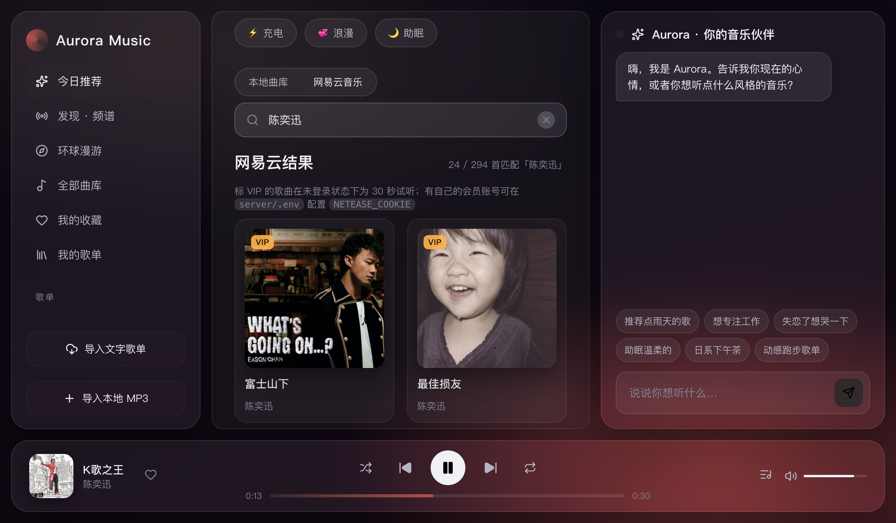

# Aurora Music · 极光音乐

一个本地运行的 AI 音乐播放器：根据心情、天气或一段描述挑选歌曲，支持搜索与播放网易云音乐的真实曲目，界面为纯黑底 + 荧光强调色的极简风格。

## 功能

- **情绪 / 天气推荐**：7 种心情标签 + 天气、时段上下文，本地打分算法给出歌单
- **网易云音源**：搜索歌名 / 歌手 / 专辑，直接播放真实音频（后端代理流式传输，支持拖动进度条）
- **本地合成音源**：无网络时仍可播放内置曲目，音频由 Web Audio API 实时合成
- **AI 聊天 DJ**：点顶栏气泡按钮从右侧滑出，未配置 LLM 时走本地降级回复
- **播放器**：底部悬浮玻璃迷你条，点开是全屏 Now Playing（圆形封面 + 实时频谱环 + 波形进度条），封面色驱动全场 mesh 渐变背景，换歌 1.2 秒平滑过渡
- **发现页**：径向频谱、粒子、滚动歌词，支持全屏沉浸
- **封面取色**：从当前封面提取主色调，驱动全场 mesh 渐变背景与强调色
- **文字歌单 / MP3 / LRC 导入**

快捷键：`Space` 播放暂停 · `←/→` 切歌 · `↑/↓` 音量 · `F` 沉浸 · `D` 切换首页/发现 · `Esc` 退出沉浸

## 技术栈

React 19 · TypeScript · Zustand · Vite 8 · Express 5 · NeteaseCloudMusicApi

## 目录结构

```
aurora-music/
├── src/                    # 前端
│   ├── components/         # MainView / Discover / ChatPanel / MiniBar / NowPlaying / MeshBackground / SpectrumRing / WaveformBar / Sidebar / AudioEngine
│   ├── store/usePlayer.ts  # 全局播放状态
│   ├── lib/                # 合成音频、推荐算法、取色、歌词、可视化
│   └── services/api.ts     # 后端请求封装
├── server/                 # Express API（3001）
│   └── src/
│       ├── routes/         # recommend / music / weather / chat / audio
│       └── services/       # 推荐引擎、LLM、网易云适配、音频合成
├── music-api/              # 本地 NeteaseCloudMusicApi（3100）
└── screenshots/
```

## 快速开始

需要 Node.js 18+。

```bash
# 1. 安装依赖
npm install
npm --prefix server install
npm --prefix music-api install

# 2. 配置环境变量
cp server/.env.example server/.env

# 3. 分别启动三个服务（各开一个终端）
npm run music-api   # 网易云 API，端口 3100
npm run server      # 后端 API，端口 3001
npm run dev         # 前端，端口 5173（/api 已代理到 3001）
```

打开 http://localhost:5173 。

### 可选配置

| 变量 | 说明 |
| --- | --- |
| `NETEASE_COOKIE` | 自己的网易云 `MUSIC_U`，用于播放账号有权限的会员歌曲 |
| `LLM_PROVIDER` / `OPENAI_API_KEY` / `CLAUDE_API_KEY` / `DEEPSEEK_API_KEY` / `GEMINI_API_KEY` | 启用真实大模型推荐与聊天（deepseek 需先充值，gemini 有免费额度），未配置时走本地降级 |
| `WEATHER_API_KEY` | 接入 OpenWeatherMap，未配置时使用模拟天气 |

## API

| 方法 | 路径 | 说明 |
| --- | --- | --- |
| GET | `/api/music/providers` | 各音源可用状态 |
| GET | `/api/music/search?source=local\|netease&q=` | 搜索 |
| GET | `/api/music/stream/netease/:id` | 音频流代理（支持 Range） |
| GET | `/api/audio/:trackId` | 本地合成音频（WAV） |
| GET | `/api/recommend` | 基于心情/天气的推荐 |
| POST | `/api/chat` | AI 对话 |

## 已知限制

- 网易云匿名访问时，普通歌曲可完整播放，**VIP 歌曲仅 30 秒试听**；配置 `NETEASE_COOKIE` 可解锁有权限的完整版。
- QQ 音乐仅保留了 provider 占位，尚未接入。
- 项目仅供本地学习与个人使用，音源来自第三方开源接口，请遵守相关平台的服务条款。

## 截图


